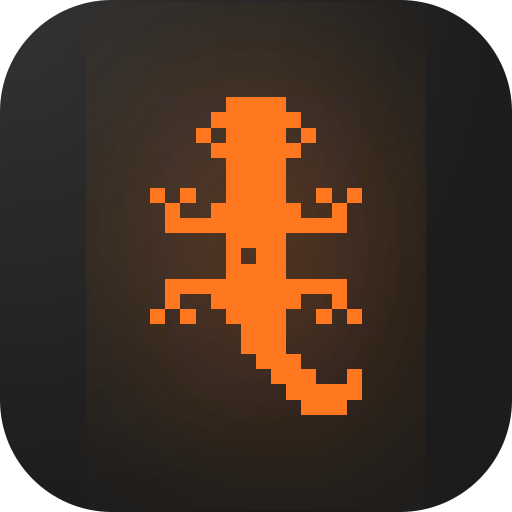

<p align="center"></p>

# Mlog

A musician's practice log, as a PWA that works offline. One page: what you're practising now, the
log of the last two weeks, and a chart of how long you've practised. Practices repeat, so the log
is also the way to start one: tap it and it runs again.

The look is [scalear](../scalear)'s: a dark hardware panel, the Silkscreen pixel font, recessed
screens and LEDs, here in the project's orange. The logo is a pixel fire salamander: *mlok* in Czech.

## Features

- **New practice**: pick the instrument (one grid: yours first, in their colours, then the rest) and the type of practice (warm-up, technique, scales,
  chords, rhythm, repertoire, improvisation, reading, ear, theory, other), write a description if
  you like and add a link. *Start* starts the timer.
- **Now**: the practice that runs, its timer (`● REC 12:34`, also in the tab's title) and *Stop*;
  a YouTube link plays in a player docked at the bottom. With nothing running, today's total and
  the last 7 days. The timer survives a reload or a locked phone (the start time is saved).
- **Log**: the last two weeks, newest first, by day with each day's total (*Two more weeks* goes
  further back). **Tap a practice to start it again** (same instrument, type, description and
  link); tap the one that runs to stop it. One practice runs at a time: starting another stops it.
  Every start and stop has *Undo* in the toast, and a practice stopped under a minute isn't kept, so a
  tap by mistake leaves nothing behind. The pencil edits a practice: its fields, and for a finished
  one the day and the minutes (for a timer left running); or deletes it.
- **Chart**: practice time by day (last 30 days), month (last 12) or year (all years, at least five),
  each column split by instrument. With two instruments or more a legend gives each one's time in
  the range. Hover or tap a column for its values; otherwise the readout shows the whole range.
- **Instruments**: 22 to pick from, each with a pixel icon (drawn in `src/instIcons.js`). The first
  New practice asks what you play; *Another instrument* adds more. Each has a **colour** of its own:
  its LED in the log and the now panel, its icon, its part of the chart. Every instrument in the
  picker shows the colour it gets: its own default, or the first free one when another of yours has
  that (not configurable). Settings renames one ("Telecaster") or removes
  it (its practices stay in the log, in its colour).
- **Settings**: language (English, Czech), instruments, and backups (see below).
- **Sharing a link** to Mlog (Android's share sheet, the manifest's `share_target`) opens New
  practice with the link filled in.

## Storage

Everything is kept in the browser (localStorage), so the app works offline and needs no server.
Settings → Backup keeps it safe:

- **Export** saves a JSON file with everything. On phones it opens the share sheet, so *Save to
  Files* puts it straight into iCloud Drive (or AirDrop it to a computer); elsewhere it downloads.
- **Import** merges a backup with what's here: for each instrument and practice the
  newer version wins, nothing newer is overwritten. So a file also carries the log from one device
  to another, in either direction.
- **Backup file** (desktop Chrome and Edge): pick a file once and Mlog saves everything to it a
  moment after each change. Keep it in iCloud Drive or Dropbox and it goes to the cloud. Each write
  first reads the file and merges in what's newer there, so other computers can use the same file
  (*Existing file*), and a file that isn't an Mlog backup is never overwritten. After the browser
  restarts it may ask for one click to allow the file again. Safari, Firefox and phones don't offer
  this (no File System Access API).
- **Reminder**: when changes have waited a week with nothing keeping them (no backup file), a
  toast offers *Back up*, once a day, and the LED on the Settings button turns yellow.
- **Keeping the data**: the app asks the browser to keep its storage (`navigator.storage.persist()`)
  and Settings says whether it will. On iPhone, Safari deletes a site's data after 7 days without a
  visit, except for apps added to the Home Screen; Settings says so there.

Records are instruments (type, name, colour) and entries (one practice: instrument, type,
description, link, start and end; no end while it runs), each with an id and `updatedAt`, so
merging a backup keeps the newer version of each. Deleting leaves a tombstone, so a merge doesn't
bring it back. The first version's records (`session`: a day on one instrument, `item`: a checklist
item) are still kept and backed up. Each session with minutes becomes an entry `e-<session id>`, so
every device makes the same one, and once made (or deleted) it isn't made again.

The app no longer syncs with a server: [api/](api/), [compose.yaml](compose.yaml),
[Dockerfile](Dockerfile) and [.github/workflows/api.yml](.github/workflows/api.yml) are left over
from that and unused.

## Run locally

The app alone, with any static server (modules and the service worker need `http://`):

```sh
python3 -m http.server 5173
# open http://localhost:5173
```

Locally the version is `dev`, and the service worker asks the server for every file, so edits show
up on a normal reload.

## Deploy

**The app** goes to GitHub Pages: every push to `master` runs
[.github/workflows/pages.yml](.github/workflows/pages.yml) (the same as scalear's: it checks that
[sw.js](sw.js) lists every published file, stamps the version and cache-busts the modules). When
adding a file, list it in `FILES` in [sw.js](sw.js). To release: `git tag v1.0.0 && git push --atomic origin master v1.0.0`.

## Structure

| File | Purpose |
| --- | --- |
| [src/store.js](src/store.js) | State, localStorage, records, queries, turning the first version's sessions into entries |
| [src/backup.js](src/backup.js) | Backups: export (share sheet) and import, the reminder, the backup file, persistent storage |
| [src/home.js](src/home.js) | The now panel and the log |
| [src/chart.js](src/chart.js) | The chart |
| [src/editor.js](src/editor.js) | The practice dialog: new and edit |
| [src/settings.js](src/settings.js) | The Settings dialog |
| [src/entries.js](src/entries.js) | Starting, stopping and repeating practices; names of instruments and practices |
| [src/links.js](src/links.js) | Links: cleaning, YouTube ids and thumbnails, the docked player |
| [src/presets.js](src/presets.js) | The instruments, their colours and the types of practice to pick from |
| [src/dates.js](src/dates.js), [src/dom.js](src/dom.js) | Days as `YYYY-MM-DD`; markup helpers, icons, toast |
| [src/i18n.js](src/i18n.js), `src/lang/` | Translations, as in scalear |
| [src/main.js](src/main.js) | Shell: rendering, the timer clock, the backup file's triggers, shared links, service worker, install |
| [sw.js](sw.js) | Service worker: offline cache, one per deploy |
| [tools/icons.py](tools/icons.py) | Draws the icons and the header's salamander from one pixel grid (Python, no dependencies) |
| `fonts/` | Silkscreen and scalear's Czech pixel font (both SIL OFL, see `fonts/OFL.txt`) |

To add a type of practice, add it to `TYPES` in [src/presets.js](src/presets.js) and its name
(`type.<key>`) to each `src/lang/*.js`. The instruments' colours are `COLORS` there: change them
only together with the dataviz palette check described beside them. To add a language, copy [src/lang/cs.js](src/lang/cs.js), list it in `LANGS` in
[src/i18n.js](src/i18n.js), import it in [src/main.js](src/main.js) and add it to `FILES` in [sw.js](sw.js).
